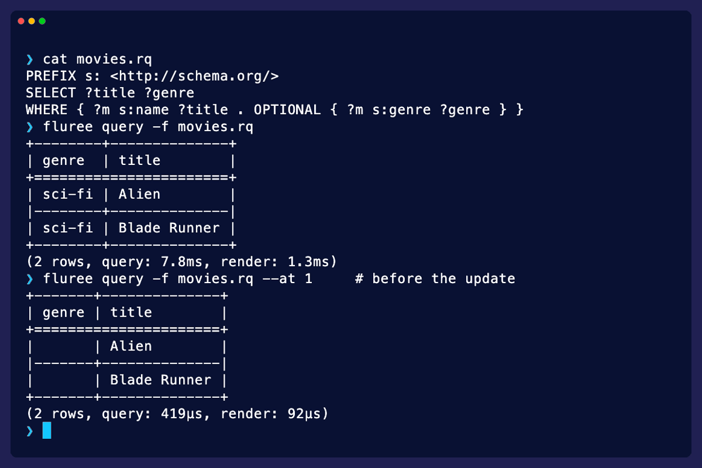
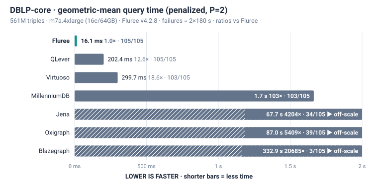

<!--
  README brand tokens (full list and sources: docs/assets/readme/BRAND.md)
  Deep #091133 (badge labels, light wordmark) · Vibrant #13C6FF (status badges) · Purple #4B57A5 (link badges)
  The benchmark block between BENCH markers is generated: python3 scripts/readme/sync-bench.py --bench-repo ../benchmark-db
-->

<p align="center">
  <a href="https://flur.ee">
    <picture>
      <source media="(prefers-color-scheme: dark)" srcset="docs/assets/readme/fluree-wordmark-dark.svg">
      
    </picture>
  </a>
</p>

<h3 align="center">The graph database that remembers everything, and proves it.</h3>

<p align="center">
  Temporal, verifiable and standards-compliant, with git-like branching and merging, integrated vector, text and geo search, and fine-grained access control: no external dependencies.<br>
  Query RDF 1.1 / 1.2 data with SPARQL, JSON-LD or openCypher, <a href="docs/ai/README.md">optimized for AI agents</a>.
</p>

<p align="center">
  <a href="https://github.com/fluree/db/releases/latest"></a> <a href="https://hub.docker.com/r/fluree/server"></a> <a href="https://github.com/fluree/db/actions/workflows/ci.yml"></a> <a href="#license"></a> <a href="https://labs.flur.ee/docs"></a> <!-- TODO(Kevin): add a community badge here once there is a public Discord or Slack. -->
</p>

<p align="center">
  <a href="#install"><b>Install</b></a> · <a href="#benchmarks"><b>Benchmarks</b></a> · <a href="#zero-to-graph-in-60-seconds"><b>60-second tour</b></a> · <a href="#for-ai-agents"><b>For agents</b></a> · <a href="#documentation"><b>Docs</b></a> · <a href="#license"><b>License</b></a>
</p>

<p align="center">
  
  <br>
  <sub>The <a href="#zero-to-graph-in-60-seconds">60-second tour</a>, recorded with <a href="https://github.com/charmbracelet/vhs">VHS</a> from <a href="docs/assets/readme/tour.tape"><code>tour.tape</code></a> on a laptop. Timings shown in the recording are not benchmarks.</sub>
</p>

<table>
  <tr>
    <td width="25%" valign="top"><b>Time travel</b><br>Query any past state by transaction number, ISO timestamp or commit ID. Every transaction is immutable.</td>
    <td width="25%" valign="top"><b>Branch &amp; merge</b><br>Branch, rebase and merge data the way you do code, each branch with its own commit history.</td>
    <td width="25%" valign="top"><b>Triple-level policy</b><br>Policies live in the ledger and decide, fact by fact, what each user can read or write.</td>
    <td width="25%" valign="top"><b>Built-in search</b><br>BM25 full-text and HNSW vector search run inside the query engine and join like any graph pattern.</td>
  </tr>
</table>

## Install

**Cloud.** Run Fluree in a dedicated serverless stack at no cost at [flur.ee/solo](https://flur.ee/solo) (usage limited), and add dedicated servers on demand. It works with the local `fluree` CLI.

**Docker.** A pre-configured HTTP server, ready for queries on port 8090. Best for trying the API or running Fluree as a service.

```bash
docker run -p 8090:8090 fluree/server:latest
```

**Homebrew, shell or PowerShell.** Installs the `fluree` binary, which bundles the CLI and the embedded server (`fluree server run`).

```bash
# Homebrew (macOS 14 or later / Linux)
brew install fluree/tap/fluree

# Shell installer (macOS 14 or later / Linux)
curl --proto '=https' --tlsv1.2 -LsSf https://github.com/fluree/db/releases/latest/download/fluree-db-cli-installer.sh | sh
```

```powershell
# Windows (PowerShell)
irm https://github.com/fluree/db/releases/latest/download/fluree-db-cli-installer.ps1 | iex
```

Binaries and changelogs for every release are on the [Releases page](https://github.com/fluree/db/releases). Pre-releases install from Homebrew as `fluree/tap/fluree-beta`, beside the stable `fluree` ([details](docs/getting-started/quickstart-server.md#option-2-homebrew-macos--linux)).

## Benchmarks

Systems with time travel, triple-level policy and reasoning are assumed to trade speed for capability. Fluree is faster than the specialist engines that have none of it.

<!-- BENCH:START -->
<!-- Generated by scripts/readme/sync-bench.py from fluree/benchmark-db@3b8b750. Do not edit by hand. -->
<table>
<tr>
<th width="50%" align="left">RDF / SPARQL · <a href="https://github.com/fluree/benchmark-db/blob/main/benchmarks/sparqloscope/reports/dblp-core/REPORT.md">DBLP-core</a></th>
<th width="50%" align="left">Property graph / Cypher · <a href="https://github.com/fluree/benchmark-db/blob/main/benchmarks/benchgraph/reports/pokec/REPORT.md">Pokec</a></th>
</tr>
<tr>
<td valign="top"><b>16.1 ms</b> geometric mean, <b>105/105</b> queries complete<br>QLever takes <b>12.6×</b> as long, Virtuoso <b>18.6×</b><br><sub>561M triples · m7a.4xlarge · SPARQLoscope, P=2</sub></td>
<td valign="top"><b>1.81 ms</b> reads · <b>2.54 ms</b> durable writes<br><b>3.32–5.75×</b> faster reads, <b>1.94–2.63×</b> faster writes than FalkorDB, Memgraph and Neo4j<br><sub>1.6M nodes / 30.6M edges · m7a.4xlarge · 35 queries</sub></td>
</tr>
</table>

<p align="center"></p>

<sub>Fluree v4.2.8, measured 2026-11-19. Other engines were measured earlier on the same instance type (Pokec peers: 2026-09-11); each report lists versions, dates and caveats. Lower latency is better.</sub>
<!-- BENCH:END -->

<!-- TODO(Kevin): the Wikidata and import-rate claims below do not match fluree/benchmark-db (see the PR description). Left unchanged pending a decision. -->
Billions of graph facts on commodity hardware. Over 2M facts/second bulk import. On the full 21.5-billion-triple Wikidata dump, all 850/850 WGPB graph-pattern queries complete with a 43 ms geometric mean, and on Wikidata-truthy (8.19B triples) the next fastest engine is 10.4x slower.

**Reproduce it yourself:** [fluree/benchmark-db](https://github.com/fluree/benchmark-db) ships pinned datasets, per-engine setup and full result sets, including MillenniumDB, Jena, Oxigraph, Blazegraph and BSBM throughput. Why it's fast: [Performance architecture](docs/design/performance.md).

## Zero to graph in 60 seconds

```bash
fluree init
fluree create movies

fluree insert '
@prefix schema: <http://schema.org/> .
@prefix ex:     <http://example.org/> .

ex:blade-runner  a schema:Movie ;
  schema:name        "Blade Runner" ;
  schema:dateCreated "1982-06-25"^^<http://www.w3.org/2001/XMLSchema#date> ;
  schema:director    ex:ridley-scott .

ex:ridley-scott  a schema:Person ;
  schema:name "Ridley Scott" .

ex:alien  a schema:Movie ;
  schema:name        "Alien" ;
  schema:dateCreated "1979-05-25"^^<http://www.w3.org/2001/XMLSchema#date> ;
  schema:director    ex:ridley-scott .
'

fluree query --format table 'SELECT ?title ?date WHERE {
  ?movie a <http://schema.org/Movie> ;
         <http://schema.org/name> ?title ;
         <http://schema.org/dateCreated> ?date .
} ORDER BY ?date'
```

```
┌──────────────┬────────────┐
│ title        │ date       │
├──────────────┼────────────┤
│ Alien        │ 1979-05-25 │
│ Blade Runner │ 1982-06-25 │
└──────────────┴────────────┘
```

That's a SPARQL query. The same query in JSON-LD:

```bash
fluree query --jsonld '{
  "@context": { "schema": "http://schema.org/" },
  "select": ["?title", "?date"],
  "where": [
    { "@id": "?movie", "@type": "schema:Movie",
      "schema:name": "?title", "schema:dateCreated": "?date" }
  ],
  "orderBy": "?date"
}'
```

And in Cypher — bare labels and properties resolve through the ledger's default `@context`, so point it at schema.org first:

```bash
fluree context set movies -e '{"@vocab": "http://schema.org/"}'

fluree query --cypher -e 'MATCH (m:Movie)
  RETURN m.name AS title, m.dateCreated AS date
  ORDER BY date'
```

All three compile to the same engine — same features, same performance.

Now update the data and query the past:

```bash
# Give every Ridley Scott movie a genre
fluree update '
PREFIX schema: <http://schema.org/>
PREFIX ex:     <http://example.org/>
INSERT { ?movie schema:genre "sci-fi" }
WHERE  { ?movie schema:director ex:ridley-scott }
'

# What did the data look like before that update?
fluree query --at 1 'SELECT ?title ?genre WHERE {
  ?movie a <http://schema.org/Movie> ;
         <http://schema.org/name> ?title .
  OPTIONAL { ?movie <http://schema.org/genre> ?genre }
}'
# → Blade Runner (no genre), Alien (no genre)

# And now?
fluree query 'SELECT ?title ?genre WHERE {
  ?movie a <http://schema.org/Movie> ;
         <http://schema.org/name> ?title .
  OPTIONAL { ?movie <http://schema.org/genre> ?genre }
}'
# → Blade Runner "sci-fi", Alien "sci-fi"
```

Every change is preserved. Query any point in history by transaction number, ISO timestamp, or commit ID.

## For AI agents

**Hand this to your coding agent.** Paste it into Claude Code, Cursor or Codex:

```text
Set up Fluree DB in this project.
1. Install the CLI: `brew install fluree/tap/fluree`. Without Homebrew, use
   `curl --proto '=https' --tlsv1.2 -LsSf https://github.com/fluree/db/releases/latest/download/fluree-db-cli-installer.sh | sh`.
2. Run `fluree init` in the project root.
3. If you are Claude Code, Cursor, VS Code, Windsurf or Zed, run
   `fluree mcp init --ide <claude-code|cursor|vscode|windsurf|zed>` to get version-matched docs over MCP.
   Otherwise use `fluree docs search "<topic>"` and `fluree docs get <page>` from the shell.
4. Read https://fluree.github.io/db/llms.txt for the docs index. Check `fluree <command> --help`
   before composing a command; don't rely on memory of older versions.
5. Run `fluree create demo`, insert a few facts about this project's domain as Turtle,
   then show me one SPARQL query and the same query with `--at 1` to demonstrate time travel.
```

**MCP server.** `fluree mcp serve` exposes ranked search over the version-pinned docs and persistent project memory over stdio. `fluree mcp init --ide claude-code` registers it for you. See [MCP server](docs/ai/mcp-server.md) and [Claude Code and the Fluree CLI](docs/ai/claude-code.md).

**Docs for agents.** The published docs follow the [`llms.txt`](https://llmstxt.org) convention: a [curated index](https://fluree.github.io/db/llms.txt) and the [full corpus](https://fluree.github.io/db/llms-full.txt). The same docs ship inside the binary (`fluree docs`), so they always match the version you run.

**Fluree Memory.** Persistent, searchable memory for Claude Code, Cursor and other AI tools: facts, decisions and preferences persist across sessions in a Fluree ledger you control, scoped per repo or per user and shareable via git. Part of the CLI. See [Fluree Memory docs](docs/memory/README.md).

**Fluree Unstructured.** `fluree doc ingest ./folder` turns PDFs, Office files, Markdown and scans into a searchable, citable knowledge graph with chunks and embeddings in a ledger you control. Deterministic and offline by default, with the best model-free parsing engine on a public 200-document benchmark. See [Fluree Unstructured docs](docs/unstructured/README.md).

## What makes Fluree different

### Performance

Dictionary-encoded integer-ID execution, columnar leaflets with region-selective decompression, aggregates answered from index directories in `O(leaflets)` rather than `O(rows)`, a regression-tested cost model, and 16 fast-path operators that fuse scan and aggregate, each with a correctness fallback to the generic pipeline.

Learn more: [Performance architecture](docs/design/performance.md), including a frank account of the current limits.

### Time travel

Every transaction is immutable. Query data as it existed at any point, by transaction number, ISO-8601 timestamp or content-addressed commit ID. No special tables, no slowly changing dimensions: it's built into the storage model.

```bash
fluree query --at 2024-06-15T00:00:00Z 'SELECT * WHERE { ?s ?p ?o }'
```

Learn more: [Time travel concepts](docs/concepts/time-travel.md), [time-travel cookbook](docs/guides/cookbook-time-travel.md).

### Property graphs & edge annotations

Attach properties to a *relationship*, not just a node: a `role` and `since` date on a `worksFor` edge, a `source` and `confidence` on a claim. Fluree implements the RDF 1.2 / SPARQL 1.2 annotation syntax, giving you labeled-property-graph edges, parallel relationships and statement-level provenance on one surface. Plain triple queries are untouched; the same shape is available in JSON-LD via `@annotation`.

```sparql
INSERT DATA { ex:alice ex:worksFor ex:acme {| ex:role "Engineer" ; ex:since 2024 |} . }
SELECT ?role ?since WHERE { ex:alice ex:worksFor ex:acme {| ex:role ?role ; ex:since ?since |} . }
```

Learn more: [Edge annotations concept](docs/concepts/edge-annotations.md), [edge-annotations cookbook](docs/guides/cookbook-edge-annotations.md).

### Integrated search

BM25 full-text and HNSW vector similarity are built into the query engine, not bolted-on services. Search results take part in joins, filters and aggregations like any other graph pattern. Dedicated search graph sources can use an embedded index or a remote `fluree-search-httpd` service.

```json
{ "@context": { "ex": "http://example.org/" }, "from": "mydb:main",
  "where": [{ "@id": "?doc", "ex:title": "?title" },
            ["bind", "?score", "(fulltext ?title \"knowledge graph\")"]],
  "select": ["?doc", "?title", "?score"], "orderBy": [["desc", "?score"]], "limit": 10 }
```

Learn more: [BM25 full-text](docs/indexing-and-search/bm25.md), [vector search](docs/indexing-and-search/vector-search.md), [search cookbook](docs/guides/cookbook-search.md).

### Git-like data management

Branch, rebase, merge, push and pull: the workflow developers already use for code, applied to data. Fork a dataset to experiment without touching production, and merge when ready. Every branch has its own commit history.

```bash
fluree branch create experiment
fluree use mydb:experiment
fluree branch rebase experiment    # catch up with main
fluree branch merge experiment     # fast-forward merge into main
```

Learn more: [branching cookbook](docs/guides/cookbook-branching.md), [Ledgers and the nameservice](docs/concepts/ledgers-and-nameservice.md).

### Triple-level access control

Policies are data in the ledger, enforced at query and transaction time. Users see only what they're authorized to see: not rows, not tables, individual facts. No application-layer filtering required.

Learn more: [Policy enforcement](docs/concepts/policy-enforcement.md), [policy cookbook](docs/guides/cookbook-policies.md), [Policy model and inputs](docs/security/policy-model.md).

### Reasoning and inference

RDFS subclass and subproperty reasoning, OWL 2 RL forward-chaining, and user-defined Datalog rules. The database infers facts you didn't explicitly store.

Learn more: [Reasoning and inference](docs/concepts/reasoning.md), [OWL & RDFS support](docs/reference/owl-rdfs-support.md), [Datalog rules](docs/query/datalog-rules.md).

### Standards-first

Full SPARQL 1.1 with zero compliance failures against the W3C test suite, and native JSON-LD for idiomatic JSON APIs. SPARQL, JSON-LD and openCypher compile to the same engine with the same capabilities: time travel, policies, graph sources and all. GraphQL is derived from your data and runs on that engine too, with policy applied.

Learn more: [SPARQL](docs/query/sparql.md), [JSON-LD Query](docs/query/jsonld-query.md), [openCypher](docs/query/cypher.md), [GraphQL](docs/query/graphql.md), [Standards and feature flags](docs/reference/compatibility.md).

### Also worth knowing

- **[SHACL validation](docs/guides/cookbook-shacl.md)**: shape constraints enforced at transaction time, with violations reported per target and per property.
- **[OWL ontology imports](docs/design/ontology-imports.md)**: pull external vocabularies into a ledger via `f:schemaSource` + `owl:imports`, materialized at commit time.
- **[Apache Iceberg / R2RML](docs/graph-sources/iceberg.md)**: query Parquet warehouses and relational stores as graph sources alongside native Fluree data.

<!-- TODO(Kevin): "How Fluree compares" table (Fluree vs. graph DB / vector DB / warehouse) goes here once the "Fluree versus the stack" matrix is supplied. -->

## Use it your way

**CLI.** Explore data, script pipelines and manage ledgers from the terminal.
```bash
fluree query -f report.rq --format csv > output.csv
```

**HTTP server.** `fluree server run` gives you a production API with OIDC auth, content negotiation and OpenTelemetry.
```bash
fluree server run
curl -X POST http://localhost:8090/v1/fluree/query?ledger=mydb:main \
  -H "Content-Type: application/sparql-query" \
  -d 'SELECT ?s ?p ?o WHERE { ?s ?p ?o } LIMIT 10'
```

**Rust library.** Embed Fluree in your application. No server process needed.
```rust
let fluree = FlureeBuilder::memory().build_memory();
fluree.create_ledger("mydb").await?;

let result = fluree.graph("mydb:main")
    .query()
    .sparql("SELECT ?s WHERE { ?s a <http://schema.org/Person> }")
    .execute()
    .await?;
```

**MCP server.** Expose Fluree to AI assistants over the Model Context Protocol. See [For AI agents](#for-ai-agents).
```bash
fluree mcp serve            # stdio transport for Claude Desktop, Cursor, etc.
```

## Capabilities

| | |
|---|---|
| **Performance** | [Columnar integer-ID engine, cost-based planner, fused fast-path operators](docs/design/performance.md) — [benchmarks](https://github.com/fluree/benchmark-db) |
| **Query languages** | [SPARQL 1.1](docs/query/sparql.md), [JSON-LD Query](docs/query/jsonld-query.md), [openCypher](docs/query/cypher.md), [GraphQL](docs/query/graphql.md) (schema derived from your data) |
| **Data formats** | JSON-LD, [Turtle, TriG](docs/transactions/turtle.md), N-Triples, N-Quads |
| **Edge annotations** | [Property-graph edges & statement-level metadata (RDF 1.2 / SPARQL 1.2)](docs/concepts/edge-annotations.md) |
| **Time travel** | [Transaction number, ISO timestamp, commit ID](docs/concepts/time-travel.md) |
| **Full-text search** | [Integrated BM25 with Block-Max WAND](docs/indexing-and-search/bm25.md) |
| **Vector search** | [Embedded HNSW or remote service](docs/indexing-and-search/vector-search.md) |
| **Reasoning** | [RDFS, OWL 2 QL, OWL 2 RL, Datalog rules](docs/reference/owl-rdfs-support.md) |
| **Access control** | [Triple-level policy enforcement](docs/concepts/policy-enforcement.md) |
| **Geospatial** | [GeoSPARQL, S2 cell indexing](docs/indexing-and-search/geospatial.md) |
| **Verifiability** | [JWS-signed transactions, Verifiable Credentials](docs/api/signed-requests.md) |
| **Data sources** | [Apache Iceberg](docs/graph-sources/iceberg.md), [R2RML relational mappings](docs/graph-sources/r2rml.md) |
| **Storage backends** | [Memory, file, AWS S3 + DynamoDB, IPFS](docs/operations/storage.md) |
| **Replication** | [Clone, push, pull between instances](docs/operations/query-peers.md) |
| **Branching** | [Fork ledgers, independent commit histories](docs/guides/cookbook-branching.md) |
| **Observability** | [OpenTelemetry tracing, structured logging](docs/operations/telemetry.md) |
| **Validation** | [SHACL shape constraints](docs/guides/cookbook-shacl.md) |

## Documentation

Hosted docs live at [labs.flur.ee/docs](https://labs.flur.ee/docs). The source is in [`docs/`](docs/README.md):

- [Getting started](docs/getting-started/README.md): install, create a ledger, write and query data
- [Fluree for SQL developers](docs/getting-started/fluree-for-sql-developers.md): coming from relational? Start here
- [End-to-end tutorial](docs/getting-started/tutorial-end-to-end.md): build a knowledge base using search, time travel, branching and policies
- [Concepts](docs/concepts/README.md): time travel, graph sources, policies, verifiable data
- [Guides](docs/guides/): cookbooks for [search](docs/guides/cookbook-search.md), [time travel](docs/guides/cookbook-time-travel.md), [branching](docs/guides/cookbook-branching.md), [policies](docs/guides/cookbook-policies.md) and [SHACL](docs/guides/cookbook-shacl.md)
- [Query languages](docs/query/README.md): SPARQL, JSON-LD, openCypher and GraphQL reference
- [Transactions](docs/transactions/README.md): insert, upsert, update patterns
- [CLI reference](docs/cli/README.md): all commands and options
- [HTTP API](docs/api/README.md): server endpoints and authentication
- [Operations](docs/operations/README.md): configuration, deployment, telemetry
- [AI agents](docs/ai/README.md): MCP server, Claude Code, `llms.txt`
- [Contributing](docs/contributing/README.md): build from source, run tests, PR workflow

## In this repo

| Path | What it is |
|---|---|
| [`fluree-db-cli`](fluree-db-cli) | Command-line interface for Fluree DB: the `fluree` binary |
| [`fluree-db-server`](fluree-db-server) | HTTP REST API server for Fluree DB |
| [`fluree-db-api`](fluree-db-api) | High-level API for Fluree DB operations (the Rust library entry point) |
| [`fluree-db-core`](fluree-db-core) | Runtime-agnostic core library for Fluree DB queries |
| [`fluree-db-query`](fluree-db-query) | Query execution engine |
| [`fluree-db-sparql`](fluree-db-sparql) · [`fluree-db-cypher`](fluree-db-cypher) · [`fluree-db-graphql`](fluree-db-graphql) | SPARQL 1.1 and openCypher 9 parsers with LLM-friendly diagnostics; GraphQL schema derivation and query lowering |
| [`fluree-db-transact`](fluree-db-transact) · [`fluree-db-indexer`](fluree-db-indexer) | Transaction support and index building |
| [`fluree-db-policy`](fluree-db-policy) | Policy enforcement for queries and transactions |
| [`fluree-db-mcp`](fluree-db-mcp) · [`fluree-db-memory`](fluree-db-memory) | The MCP service (memory and docs toolsets) and the developer memory layer |
| [`fluree-db-doc`](fluree-db-doc) | Document ingestion: a folder of documents into a structure graph with retrieval chunks and embeddings |
| [`fluree-db-python`](fluree-db-python) · [`fluree-db-wasm`](fluree-db-wasm) · [`fluree-react`](fluree-react) | Python package core, browser (wasm) bindings, and React hooks for live queries |
| [`docs/`](docs/README.md) | The documentation source, published to [fluree.github.io/db](https://fluree.github.io/db/) and embedded in the binary |
| [`testsuite-sparql`](testsuite-sparql) · [`testsuite-shacl`](testsuite-shacl) | W3C conformance suites |
| [`contrib/`](contrib) | Community packaging (Arch Linux AUR) |

## License

Licensed under the [Business Source License 1.1](LICENSE), with a Change Date
to Apache License 2.0 as specified in that file.

In short: you may use Fluree in production for anything except offering
Fluree itself to others as a hosted or managed database. Building your own
applications and data products on Fluree is permitted, including publishing a
dataset you curate with a public, read-only query endpoint. See the
[License FAQ](docs/reference/license-faq.md) for details.

<br>

<p align="center">
  <a href="https://flur.ee">
    <picture>
      <source media="(prefers-color-scheme: dark)" srcset="docs/assets/readme/fluree-wordmark-dark.svg">
      
    </picture>
  </a>
  <br>
  <sub><a href="https://flur.ee">Website</a> · <a href="https://labs.flur.ee/docs">Docs</a> · <a href="https://www.linkedin.com/company/fluree-pbc">LinkedIn</a> · <a href="https://flur.ee/careers">Careers</a></sub>
  <!-- TODO(Kevin): add X and YouTube once confirmed; twitter.com/flureeDB and youtube.com/@FlureePBC returned 404 on 2026-11-20. -->
</p>
